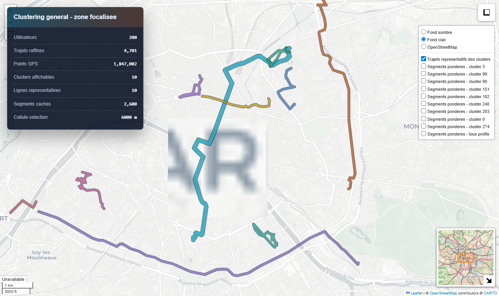
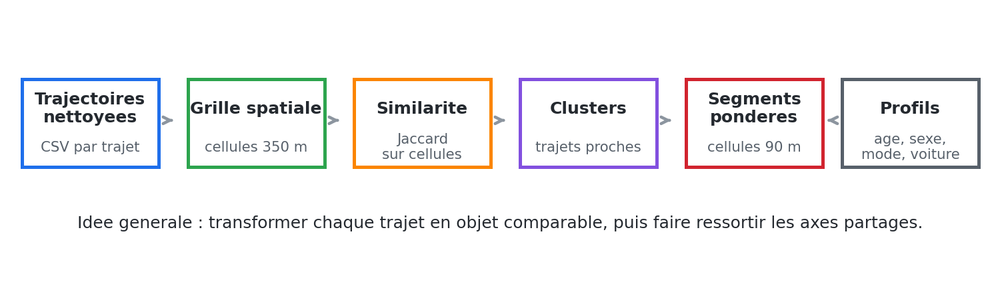
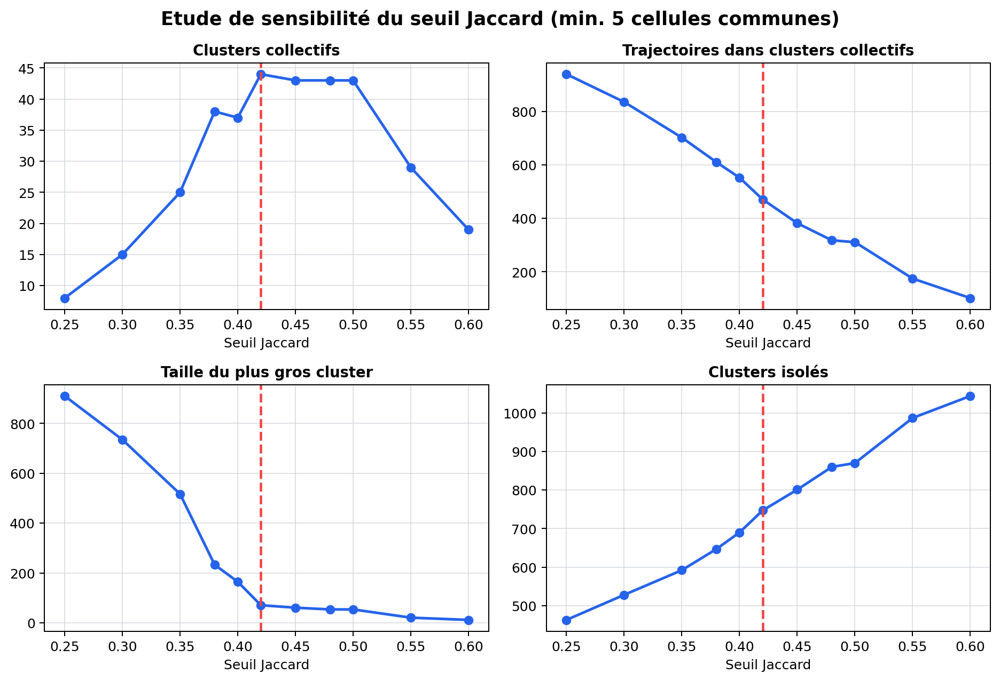
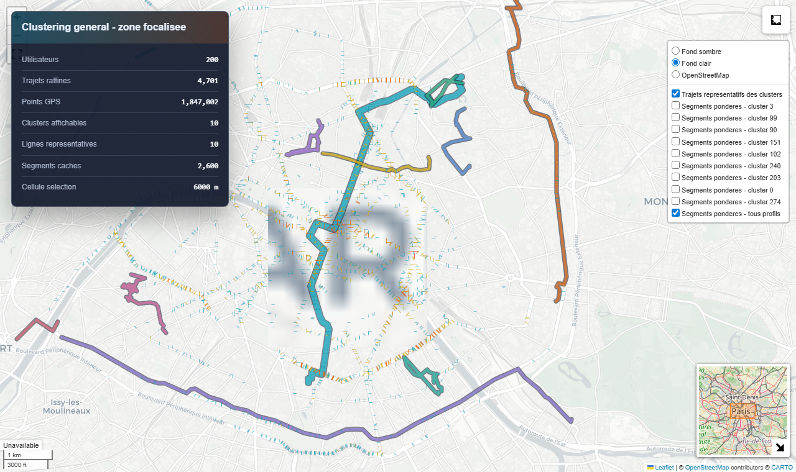
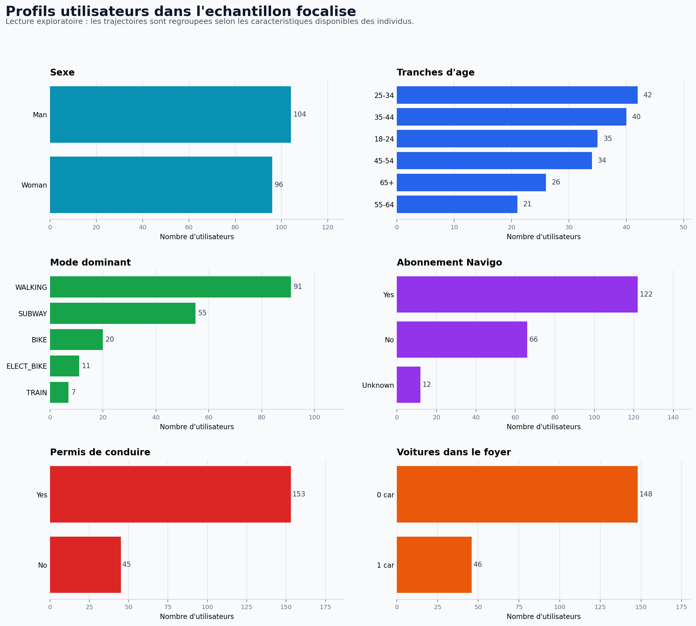
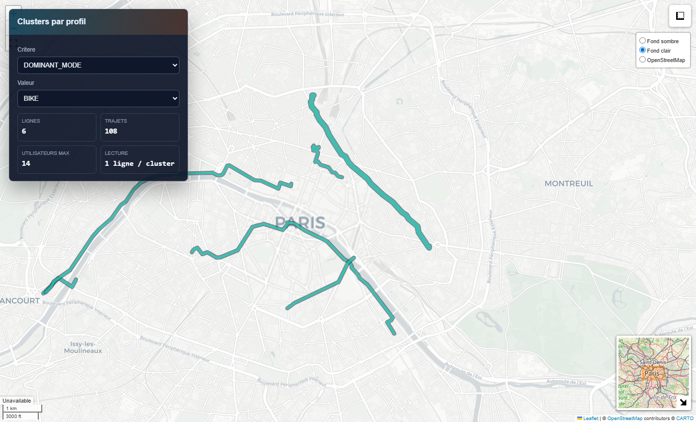
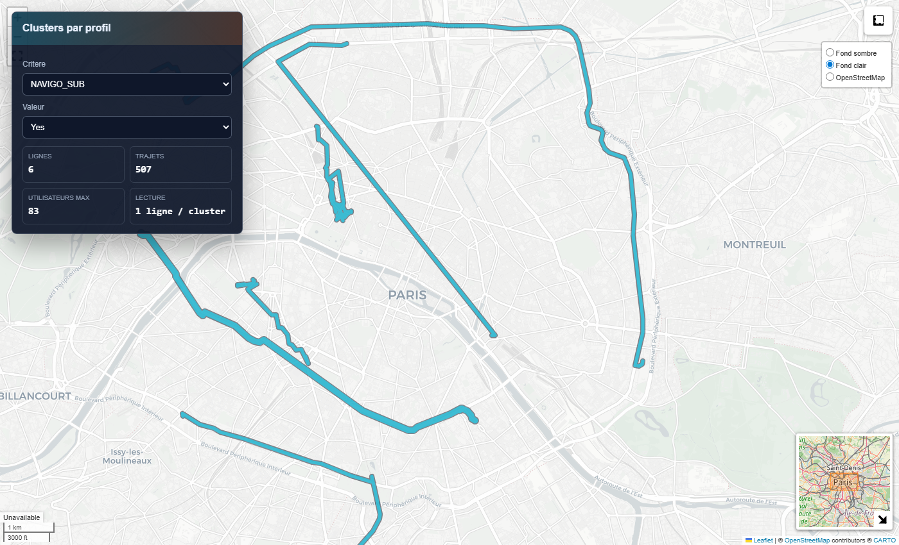
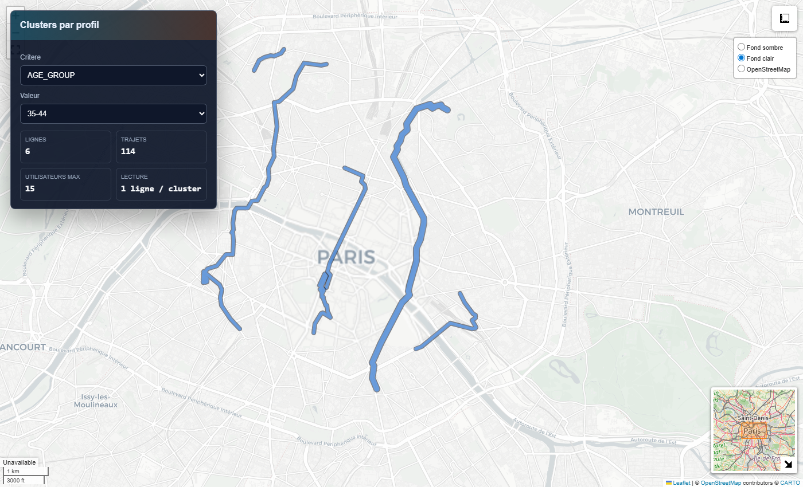

# PTIR · Human mobility analysis from GPS trajectories

**Which routes do people in Paris actually share, and do they differ by age, sex or transport mode?**
This research project builds a complete pipeline that turns raw GPS traces into comparable trajectories, clusters them, and extracts the common corridors of an urban population.



<sub>Representative clusters for 200 users of the same zone: 4,701 refined trips, 1.8 M GPS points.</sub>

## Highlights

- **Full data pipeline** applied to the 2,036 raw CSV files of the NetMob25 GPS dataset (Île-de-France): cleaning, stay-point detection, trip segmentation, trimming and resampling, producing one multi-GB file of refined trajectories
- **Trajectory similarity** by projecting each trip onto a spatial grid and comparing the cell sets with the **Jaccard index**
- **Data-driven parameter choice**: a sensitivity study over thresholds from 0.25 to 0.60 to pick a value that avoids both over-merging and fragmentation
- **Shared corridors** extracted as weighted segments on a finer grid
- **Profile analysis**: the same method applied per age group, sex, main transport mode, car ownership and Navigo pass holding
- **Interactive maps** (Folium / Leaflet) and automated PNG captures for the report

**Stack:** Python · pandas · Folium / Leaflet · Matplotlib · Playwright (map captures) · Pillow

## Method



1. **Clean and segment** the raw GPS traces (outliers, stay points, trip boundaries, edge trimming, sampling).
2. **Project** every trip onto a spatial grid (350 m cells).
3. **Compare** trips with the Jaccard similarity of their cell sets.
4. **Cluster** similar trips and keep a representative line for each cluster.
5. **Aggregate** weighted segments on a 90 m grid to reveal common corridors.
6. **Cross with user profiles** (age, sex, mode, car, Navigo).

The thresholds used for cleaning (time gaps, distances, speeds, stay-point durations) were chosen from an exploratory analysis of their distributions, kept in [`analyse&test/`](analyse&test/).

### Choosing the Jaccard threshold



- **General analysis:** thresholds from `0.25` to `0.60` were tested, with at least `5` shared cells. **`0.42`** was kept as the compromise: it limits over-merging while still producing interpretable collective clusters.
- **Focused and per-profile analysis:** lowered to **`0.35`**. On a sub-sample, and even more after filtering by profile, there are fewer comparable trips, and `0.42` fragmented the results too much.

The profile analysis uses a focused sample of `200` users and shows up to `6` representative clusters per profile.

## Results

| Shared corridors (weighted segments) | Profile breakdown of the sample |
|---|---|
|  |  |

Representative clusters per profile:

| Bike users | Navigo pass holders | Age 35–44 |
|---|---|---|
|  |  |  |

All report figures are in [`results/report_assets/`](results/report_assets/). Interactive HTML maps are generated in `results/focused_clustering_output/`; most are not versioned because they can get large.

## Repository layout

| Path | Content |
|---|---|
| [`src/`](src/) | Python scripts of the pipeline and the analyses |
| [`sample_data/`](sample_data/) | Small data subset to rerun a demo |
| [`results/report_assets/`](results/report_assets/) | Final figures and map captures used in the report |
| [`results/focused_clustering_output/`](results/focused_clustering_output/) | Summary CSVs of the focused analysis |
| [`results/jaccard_threshold_study/`](results/jaccard_threshold_study/) | Charts and CSV of the threshold study |
| [`analyse&test/`](analyse&test/) | Exploratory analysis behind the cleaning thresholds |
| [`docs/references/`](docs/references/) | Reference papers |

### Main scripts

| Script | Role |
|---|---|
| `src/gps_pipeline.py` | Initial pipeline: cleaning, stay points, segmentation, trimming, sampling |
| `src/trajectory_clustering.py` | General clustering of trajectories by grid cells and Jaccard similarity |
| `src/analyze_jaccard_threshold.py` | Sensitivity study of the Jaccard threshold (0.25 to 0.60) |
| `src/focused_clustering.py` | Focused analysis on users of one zone: clusters, segments and profiles |
| `src/aggregate_common_paths.py` | Aggregation of weighted segments and common corridors |
| `src/capture_existing_maps.py` | PNG captures of the general maps |
| `src/capture_profile_map_images.py` | PNG captures of the per-profile maps |
| `src/visualize_profile_summary.py` | Chart of the profile breakdown |
| `src/create_sample_data.py` | Builds the demo subset from local outputs |

## Run it

```bash
pip install -r requirements.txt
```

**Demo with the data included in the repository:**

```bash
python src/focused_clustering.py --target-users 200 --reuse-selection --reuse-focused-points \
  --focused-output sample_data/focused_demo_refined_trajectories.csv \
  --selected-users-output sample_data/selected_same_zone_users.csv \
  --individuals-input sample_data/individuals_dataset.csv \
  --displacements-input sample_data/displacements_dataset.csv \
  --jaccard-threshold 0.35 --profile-map-top-clusters 6
```

**Full analysis** (requires the large local files):

```bash
python src/focused_clustering.py --target-users 200 --jaccard-threshold 0.35 --profile-map-top-clusters 6
```

**Regenerate the figures:**

```bash
python src/capture_existing_maps.py         # general map captures
python src/capture_profile_map_images.py    # per-profile map captures
python src/visualize_profile_summary.py     # profile breakdown chart
```

### About the data

The full dataset is not versioned: `all_refined_trajectories.csv` weighs several GB, intermediate CSVs reach tens to hundreds of MB, and the source files (`NetMob25CleanedData/`) stay local. To keep the project reproducible, [`sample_data/`](sample_data/) contains:

| File | Description |
|---|---|
| `focused_demo_refined_trajectories.csv` | Focused, sub-sampled GPS points for 200 users |
| `selected_same_zone_users.csv` | The 200 users of the focused zone |
| `individuals_dataset.csv` | Individual attributes used for profiles |
| `displacements_dataset.csv` | Dominant transport modes used for profiles |

This subset does not replace the full dataset, but it is enough to rerun the clustering and profile analysis.

## References

- Li et al., *A Trajectory Collaboration Based Map Matching Approach for Low-Sampling-Rate GPS Trajectories*, Sensors, 2020. [mdpi.com/1424-8220/20/7/2057](https://www.mdpi.com/1424-8220/20/7/2057)
- Ville de Paris, *Les Rives de Seine s'offrent à vous*. [paris.fr](https://www.paris.fr/pages/les-rives-de-seine-s-offrent-a-vous-21328)

---

Research project (PTIR) at INSA Lyon · **Anas Sfar** · [LinkedIn](https://www.linkedin.com/in/anas-sfar-331071370/)
